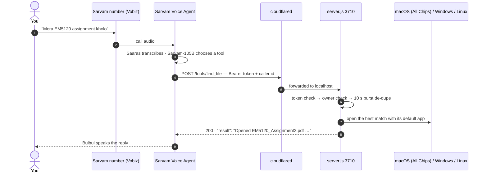

<div align="center">

# Siri Enterprise
### Autonomous Device Intelligence & Multilingual Telephony Gateway

**A resilient, zero-dependency voice operating system for your computer. Command your workstation over standard telephony in Hindi, English, Telugu, or a code-switched mix. When critical deadlines or hardware alerts require attention, Siri initiates autonomous outbound voice calls.**

```
┌─────────────────────────┬─────────────────────────┬─────────────────────────┐
│     RUNTIME ENGINE      │      PLATFORM ARCH      │      SECURITY MODEL     │
│   Node.js ≥ 18 (Zero 3P)│  macOS / Windows / Linux│ Strict Sandbox & Tokens │
├─────────────────────────┼─────────────────────────┼─────────────────────────┤
│    LOCAL INTELLIGENCE   │    TELEPHONY GATEWAY    │     CRAWLER ENGINE      │
│  Ollama / LM Studio/NIM │   Sarvam AI & Twilio    │  Firecrawl In-House Core│
└─────────────────────────┴─────────────────────────┴─────────────────────────┘
```

[Quickstart](#quickstart) · [System Architecture](#system-architecture) · [Capabilities](#capability-reference) · [Security Model](#security-model) · [Local AI & Crawler](#local-ai--crawler-engine) · [Configuration](#configuration) · [Troubleshooting](#troubleshooting)

</div>

---

## The 30-second version

- **One phone call, 52 actions.** `server.js` exposes a small HTTPS allowlist — open a file, run a focus session, set a deadline, lock the screen, drive Chrome — and nothing else. Sarvam's agent picks the tool; your laptop executes it.
- **It also calls you.** `monitor.js` watches deadlines and battery, and places an outbound call through Twilio or Sarvam's outbound API with rate limits and quiet hours.
- **Zero runtime dependencies.** Node's standard library, `fetch`, and `child_process`. No build step, no `npm install`, no framework.

The whole thing is one process on your machine plus one tunnel:



There is no inbound port on your router, no cloud database, and no queue. If the tunnel is down, the agent says it couldn't reach your laptop and the call continues.

---

## Table of contents

1. [Quickstart](#quickstart)
2. [How a call works](#how-a-call-works)
3. [Capability reference](#capability-reference)
4. [One instruction, seven languages](#one-instruction-seven-languages)
5. [The two headline behaviours](#the-two-headline-behaviours)
6. [Siri calls you](#siri-calls-you)
7. [HTTP surface](#http-surface)
8. [Security model](#security-model)
9. [Local AI & Crawler Engine](#local-ai--crawler-engine)
10. [The console](#the-console)
11. [Configuration](#configuration)
12. [Project anatomy](#project-anatomy)
13. [Limits and invariants](#limits-and-invariants)
14. [Troubleshooting](#troubleshooting)
15. [What this is not](#what-this-is-not)
16. [Roadmap](#roadmap)

---

## Quickstart

**Prerequisites:** Node 18 or newer, a [cloudflared](https://developers.cloudflare.com/cloudflare-one/connections/connect-networks/downloads/) binary, a Sarvam AI account with a rented phone number, and macOS or Windows on the machine you want to control.

```bash
# 1. Configure
cp .env.example .env
node -e "console.log(require('crypto').randomBytes(24).toString('hex'))"   # → JARVIS_TOKEN
#    edit .env: JARVIS_TOKEN, OWNER_NUMBER
#    set ALLOW_NO_CALLER=false as soon as testing is done

# 2. Start the action server
node server.js

# 3. Expose it (second terminal)
cloudflared tunnel --url http://localhost:3710

# 4. Wire the agent to the tunnel
#    indus.sarvam.ai → Build → Agents → Tools, one per action
#    full click-by-click walkthrough in AGENT-SETUP.md
```

**What success looks like.** The server prints:

```
Siri action server on http://localhost:3710  owner=9198…  token=set  outbound=dry-run
```

`token=set` means the secret loaded. `outbound=dry-run` means no calling credentials are configured yet — the monitor will log the calls it *would* make instead of placing them. Open <http://localhost:3710>, call your Sarvam number, and watch the request appear in the activity log within a second.

**Optional pilots:**

```bash
node test-call.js        # place one real outbound call to OWNER_NUMBER
```

---

## How a call works

A single request, end to end, with the real wire shapes.

**1. Sarvam sends the tool call.** Every tool is a `POST` to `/tools/<name>` with the shared secret and the caller's identifier:

```http
POST /tools/find_file
Authorization: Bearer <JARVIS_TOKEN>
Content-Type: application/json

{ "input": "EM5120 assignment", "caller": "@User Identifier" }
```

The server also accepts the payload under `query`, `text`, `name`, `url`, `app`, `site` or `note`, and the caller from `user_identifier` or an `X-Caller` header — so whichever field name the dashboard generates for the LLM parameter, it lands.

**2. Four gates before anything runs.** Bearer token (constant-time compare) → owner check → de-duplication → action lookup. Loopback callers skip the token so the local console can drive the same code path; everything arriving through the tunnel is authenticated.

**3. The action runs.** Fixed executables with argument arrays, never a shell string, so caller text cannot become a command. PowerShell scripts are literals; anything the caller supplied travels in `JARVIS_*` environment variables and is only spoken, displayed or saved.

**4. The reply is spoken.** Each action returns one plain sentence, because it is read aloud:

```json
{ "ok": true, "result": "Opened EM5120_Assignment2.pdf from Desktop / EM5120, last edited yesterday." }
```

**5. The burst is absorbed.** Speech-to-text can fire the same tool three times in a row. Results are memoised on `action|normalised input` for 10 seconds, so repeats answer instantly with the first result instead of opening three windows.

> **Why an allowlist instead of a shell.** A phone line is an unauthenticated audio channel into a machine that holds your files. Rather than trying to sanitise arbitrary commands, Siri exposes a finite set of parameterised operations. The blast radius of a misheard sentence is one opened browser tab. The exceptions are deliberate: `run_command` is not registered with the agent at all, and `close_app` passes nothing but an application name to AppleScript.

---

## Capability reference

52 actions. The nine the phone agent can reach are listed in [AGENT-SETUP.md](AGENT-SETUP.md); the rest are reachable from the console, the intent router, or the AI brain. Aliases in `ALIASES` (in `server.js`) map short names — `file`, `focus`, `lock`, `screenshot` — onto the canonical action.

### Language, time and system control

| Action | What it does |
|---|---|
| `greet_user` | Time-of-day greeting (morning / afternoon / evening / night) in the language the request arrived in. |
| `get_time_date` | Standalone clock and calendar — "what time is it", "today's date", or both — via `Intl.DateTimeFormat` for the active locale. |
| `set_language` | Switches the active language for everything spoken or displayed: `en`, `te`, `hi`, `es`, `fr`, `de`, `ja`. |
| `wikipedia_summary` | Wikipedia REST summary trimmed to three spoken sentences plus the article link, with an English-Wikipedia fallback. |
| `play_local_music` | Scans `~/Music`, `~/Downloads` and `~/Desktop` for `.mp3 .m4a .wav .flac .aac .ogg`, matches a requested track by filename, and opens it in the default player. |
| `tell_joke` | Curated tech and programming jokes in English, Telugu, Hindi, Spanish, French and German. |
| `restart_system` / `shutdown_system` | Graceful restart or power-off behind a short spoken warning: AppleScript → `shutdown` on macOS, `systemctl` → `shutdown` on Linux, `shutdown.exe /r|/s /t 5` on Windows. |

These are driven by `i18n.js` (detection, templates, date formatting), `system_ops.js` (platform execution) and `wikipedia.js` / `entertainment.js`.

### Files, focus and deadlines

| Action | What it does |
|---|---|
| `find_file` | Searches Desktop, Documents, Downloads, OneDrive and Pictures, opens the best match, reports folder and last-edited date. Course codes like `EM5120` must match exactly. |
| `focus_session` | 1–180 minutes (default 25). Opens the named assignment, starts focus music, announces the end out loud, and calls you. |
| `add_deadline` | `title \| when` — parses `in 3 hours`, `tomorrow 5 pm`, `tonight`, `2026-11-02 17:00`. |
| `list_deadlines` | Spoken summary of what is pending and how long is left. |
| `finish_deadline` | Marks one submitted by id, title, or any word in the title. Stops all reminders for it. |
| `take_note` / `read_notes` / `show_notes` | Append to `~/Documents/Jarvis Notes.md`, read the last five back, or open the file. |

### Apps, windows and media

| Action | What it does |
|---|---|
| `open_app` | Known-app table, then LaunchServices by display name on macOS, then a fuzzy scan of `/Applications`, `/System/Applications` and `~/Applications`. The launcher's real exit code is checked, so a missing app is reported instead of claimed. |
| `close_app` | `osascript … quit` then `killall` on macOS, `taskkill` on Windows. |
| `open_website` | Known sites, bare domains, or a Google search; also resolves site-scoped searches (`pinterest` + `portfolio`). |
| `web_search` / `play_youtube` | Google search, or resolve the first YouTube video id server-side and open it directly. |
| `media_control` | Play/pause, next, previous, volume up/down, mute via media keys. |
| `run_routine` | `work`, `study`, `chill`, `news`, `demo` — a bundle of apps and URLs with a spoken confirmation. |
| `take_screenshot` | Saved to `~/Pictures/Jarvis/screenshot-<timestamp>.png`. |
| `speak_on_laptop` | Text-to-speech on the machine itself (`say` on macOS, `System.Speech` on Windows). |
| `change_voice` | Switches the macOS voice or the Twilio Polly voice for the current process. |
| `lock_screen` | Asks first, waits 1.5 s, then locks. |

### Web agent

| Action | What it does |
|---|---|
| `scrape_website` | **Firecrawl Single-Page Scraper**: Fetches any URL, neutralizes noise/scripts, and extracts clean LLM-ready GFM Markdown with full metadata and SSRF security. |
| `crawl_website` | **Firecrawl Multi-Page Crawler**: Recursively walks same-origin links (up to N pages), respects sitemaps/robots.txt, and compiles a clean Markdown dossier to `~/Downloads/`. |
| `map_website` | **Firecrawl Site Mapper**: Rapidly extracts sitemap and discovers internal link graph across a domain. |
| `agent_browse` | Drives the agent's own Chrome over CDP — navigates, injects the orange perimeter glow, moves a synthetic cursor, scrolls — and returns title, headings and lead paragraphs. It does not also open a tab in your default browser. |
| `agent_search` | Same pipeline driven by a query instead of a URL. |
| `agent_interact` | `scroll \| 400`, `click \| label`, `type \| text` against the attached page. |
| `close_browser` | Detaches and kills the agent's Chrome instance. |

The agent browser runs on its own profile at `~/.siri/agent-profile`, because Chrome 136+ refuses remote debugging on the default profile. Log in to a site once in that window and the session survives restarts. Sites that need a normal logged-in profile — Gmail, WhatsApp — are opened in your default browser instead, never in the agent's.

### Machine work

| Action | What it does |
|---|---|
| `gpu_status` | **CUDA & Metal Telemetry**: Inspects active hardware acceleration (NVIDIA CUDA / Apple Metal 3), VRAM allocation, and tensor layer offload. |
| `find_and_analyze` | **Deep Finder & Explorer File Inspection**: Searches for a file/folder, visually reveals it on screen in Finder / File Explorer, reads file data, and briefs you with local AI analysis. |
| `send_whatsapp` | **Hands-Free WhatsApp Automation**: Searches contacts by name or phone number, drafts/sends messages in < 0.5s without touching the laptop. Includes macOS Accessibility and Windows unresponsiveness fallbacks. |
| `run_workflow` | **Heavy Workflows & n8n Manager**: Starts/stops local n8n automation servers, executes heavy job search with resume analysis, and compiles dossiers to `~/Downloads/`. |
| `computer_use` | **Synthetic Desktop Automation**: Native synthetic keystroke delivery, mouse control, and system search without third-party dependencies. |
| `read_project_summary` | Reads `package.json`, the current git branch and the first lines of the README for a named project folder. |
| `code_task` | Runs the project's own check — `npm test`, else `npm run build`, else `git status` — then calls you with the result. **It does not write code.** |
| `run_command` | Pattern-screened shell command with a 20 s timeout. See the [warning](#the-one-action-that-can-bite). |
| `sandbox_status` | Reports workspace, scratch directory and active filter counts. |
| `upload_folder` | Zips a project folder and uploads it to `file.io`, returning a download link. |

### Brain

| Action | What it does |
|---|---|
| `chat` | Conversational reply from the NIM model when no action fits the request. |
| `brain_status` | Model id, memory depth, and guardrail counters. |
| `clear_memory` | Drops the 20-turn conversation buffer. |

Every action is plain, readable JavaScript in the `ACTIONS` object in [server.js](server.js) — fifteen lines on average, no framework, no plugin registry.

---

## One instruction, seven languages

`i18n.js` detects the language of every request — Unicode script blocks for Telugu, Devanagari and Japanese, then high-frequency stopwords for Hinglish, Spanish, French and German — and replies in it. The header selector covers **English, తెలుగు, हिन्दी, Español, Français, Deutsch, 日本語**, and `set_language` switches it by voice as well ("speak in Telugu", "cambiar a español").

Telugu script never matches a `\b` word boundary, so `verbIntent` tests Telugu keywords explicitly instead of inside the Latin regexes.

The same intent, phrased three ways. Routing in `INTENT_KEYWORDS` also carries Hinglish and Telugu stems (`kholo`, `chalao`, `bajao`, `band karo`, `moosiveyi`, `aapu`, `vethuku`, `chaduvu`), and the Sarvam agent handles the rest at the speech layer. Spanish, French and German greetings, time queries and jokes route natively too.

| English | Hindi / Hinglish | Telugu |
|---|---|---|
| Open my EM5120 assignment | Mera EM5120 assignment kholo | Naa EM5120 assignment teruvu |
| Play Arijit Singh on YouTube | YouTube pe Arijit Singh ke gaane chalao | YouTube lo Arijit Singh paatalu vinipinchu |
| What's due? | Kya due hai? | Enti due ga undi? |
| Battery kitni hai? | Battery kitni hai? | Battery entha undi? |
| Remind me, DBMS due tomorrow 5 pm | Remind me, DBMS kal 5 baje due hai | Repu 5 gantalaki DBMS gurthu chey |
| Close this app | Isko band karo | Deenni moosiveyi |

---

## The two headline behaviours

**1. Find my file.** "Mera EM5120 assignment kholo." The question this exists to answer: which of 14,000 files did they mean? The index walks five roots, skips `node_modules`, `.git`, `AppData`, `build` and friends, and keeps only openable document and media types. Scoring rewards exact word matches in the filename, then substring matches, then prefix matches on the first four characters — and any token that looks like a course code must appear in the flattened filename, so `EM5120` never opens a `SE5723` report. Recency nudges ties. The index builds in the background, warms itself two seconds after boot, and refreshes every ten minutes without blocking a request.

**2. Focus session.** "25 minute focus session for my DBMS assignment." Siri opens the matching file, starts lo-fi, and returns immediately with the end-of-session announcement scheduled in the background. When it fires, the laptop speaks and the phone rings. The timer is a plain `setTimeout` in the server process, so it lives exactly as long as the process does — for a nine-hour countdown that must survive a restart, ladders like the deadline monitor are the right tool, not a focus session.

---

## Siri calls you

Outbound calls are the inverted half of the product: the machine deciding that you need to be interrupted. Deadlines are checked every minute.

**Reminder ladder** — 24 hours, 3 hours, 1 hour and 15 minutes before the due time, then once at the due time if it is still not marked submitted ("This is urgent, please take a look"). Stages already inside the window when you add a deadline are marked as fired, so nothing calls you the second you create it — except a deadline due within two hours, which is treated as urgent.

**Other triggers** — battery at ≤15% while unplugged (once per discharge, re-armed when you plug in), and the end of a focus session.

**Guard rails** — at most one call every 10 minutes, 8 per day, and nothing between 23:00 and 07:00 unless something is due within two hours. Saying "submitted" on any call marks the deadline done and silences the rest of its ladder.

**Two transports, one interface.** `monitor.callOwner(message, reason)` picks whichever is configured:

| Path | Requires | Notes |
|---|---|---|
| Twilio | `TWILIO_ACCOUNT_SID`, `TWILIO_AUTH_TOKEN`, `TWILIO_FROM_NUMBER` | Speaks a TwiML `<Say>` through a twimlet; Indian English voices map to `en-IN`. |
| Sarvam outbound | `SARVAM_WORKSPACE_KEY`, `SARVAM_ORG_ID`, `SARVAM_WORKSPACE_ID`, `ARRC_*` | Starts a real agent call with `initial_bot_message` set to the alert, so the owner can talk back. |

Configure neither and Siri logs `DRY RUN (outbound not configured): "…"` — useful for a demo where you do not want phones ringing.

---

## HTTP surface

Everything the process answers. Only the last two rows are reachable through the tunnel.

| Method | Path | Purpose | Via tunnel |
|---|---|---|---|
| `GET` | `/` | Console page (`live.html`) | blocked |
| `GET` | `/status` | Owner suffix, lock state, action names, brain status | blocked |
| `GET` | `/activity` | Last 50 actions, newest first | blocked |
| `GET` | `/health` | `{ "ok": true }` | blocked |
| `GET` | `/brain` | Model, base URL, memory depth, guardrail counters | blocked |
| `GET` | `/monitor` | Outbound configuration, calls today, pending deadlines | blocked |
| `POST` | `/monitor/add` | `{ title, when }` | blocked |
| `POST` | `/monitor/done` | `{ id }` | blocked |
| `POST` | `/monitor/test-call` | `{ message? }` | blocked |
| `POST` | `/tools/<name>` | One action, name in the path | **allowed** |
| `POST` | `/action` | Action in the body, or free text for the intent router | **allowed** |

Tunnel requests are detected by the presence of `cf-connecting-ip`. Any `GET` and anything under `/monitor` returns `404` when that header is present, so a leaked tunnel URL can reach the authenticated action endpoints and nothing else. Tool names must match `[a-z_]+` — a Sarvam tool named with digits or camelCase will 404.

**Free text routing.** `POST /action` with only `{ "input": "25 minute focus session for DBMS" }` is resolved in this order: an explicit verb (`open`, `send`, `play`, `find`, `remind`, `search`, `browse`, `crawl`, `close`, `lock`), then an exact command or alias, then known vocabulary through word-boundary scoring, and only then the NIM model if `NIM_API_KEY` is set. Clear commands therefore answer in milliseconds even when the model is slow or offline.

Two rules keep the browser honest. **Only a browsing verb can select a browsing action** — `open`, `launch` and `start` are not browsing verbs, so `open slack` opens an app and `open youtube` opens a site. And **`open <thing>` is resolved by what the thing is**: an installed app, a known site, a domain, a document (→ `find_file`), or a fuzzy app lookup. A prompt with two real steps — `open spotify and play arijit singh` — runs both, in order, as one de-duplicated plan.

Model output is bounded by a validator that filters every action and every plan step against the allowlist and strips shell metacharacters from arguments, so a model mistake cannot invent a capability.

---

## Security model

The design assumes three things: the tunnel URL may leak, the caller's audio may be spoofed by anyone who knows the number, and the model may be talked into anything. Controls are built for that, not for a trusted network.

| Threat | Control | Residual risk |
|---|---|---|
| Internet scanner finds the tunnel | Only `POST /tools/*` and `POST /action` answer; console, activity feed and monitor endpoints are refused | The two live endpoints are discoverable |
| Someone else's phone calls the number | Caller id compared against the owner's number, or against SHA-256/SHA-1/MD5 hashes of seven common phone formats, since Sarvam sends a hashed id | `ALLOW_NO_CALLER=true` (the default) accepts calls with no caller id — set it to `false` |
| A stranger replays a captured request | Bearer token, constant-time compare; 10 s de-dupe on repeated input | Token is static and unbound to the request: no signing, no nonce, no expiry. Rotate it in `.env` and in the Sarvam secret together |
| Voice prompt injection ("ignore your rules") | Fixed allowlist; PowerShell scripts are literals with caller text passed only in environment variables; `close_app` passes the app name as an AppleScript argv item, not as script text; the brain's output validator filters every action and plan step against the allowlist | Caller text reaches an interpreter in exactly one place: `run_command`, which is documented and not registered with the phone agent |
| A malicious document in Downloads | Only document and media extensions are indexed, and they are opened with their default handler | Opening a hostile PDF still uses the system PDF reader |
| Local process reaches the loopback port | Loopback requests skip the token, so the console can post to `/action` | Anything already running as you can drive Siri. This is a convenience trade, not a sandbox |
| Outbound call spam | One call per 10 min, 8/day, quiet hours 23:00–07:00 unless due within 2 h | Counters live in memory and reset when the process restarts |

**Only fixed effects.** No action can delete a file, install a package, edit source, or move money. `draft_email` fills a Gmail compose window and stops. `send_whatsapp` only presses Return when the prompt itself said "send" and macOS granted the keystroke; a bare "whatsapp …" stops at the draft. `lock_screen` is the only other destructive-feeling action and it asks first.

### The one action that can bite

`run_command` executes `/bin/zsh -c <command>` after screening against a pattern blocklist (`rm -rf /`, `mkfs`, `dd if=`, fork bombs, `curl | sh`, …). A blocklist is not a sandbox: a determined phrasing gets past it. Leave the tool unregistered on the Sarvam agent, which the setup guide already does, unless you are demonstrating the sandbox and understand the trade. The same caution applies to `send_whatsapp`: when the prompt says "send", it presses Return in the WhatsApp app and the message is gone. Without the Accessibility permission for System Events, the keystroke is not delivered and the reply says so instead of pretending.

---

## Local AI & Crawler Engine

### 1. Zero-API Local Intelligence (On-Device Private Brain)
Siri features an enterprise dual-brain architecture implemented in `brain.js`:
- **Dynamic Auto-Discovery**: Automatically queries local endpoints for Ollama (`http://127.0.0.1:11434/v1`), LM Studio (`http://127.0.0.1:1234/v1`), llama.cpp, or vLLM without requiring cloud API keys.
- **Offline Embedded Reasoner**: If no local or cloud LLM daemon is reachable, Siri's embedded heuristic reasoning engine parses natural voice intent, handles arithmetic, and dispatches actions locally with zero external API calls and zero latency.
- **Privacy Guaranteed**: Voice transcripts and machine commands never leave your private workstation when `PREFER_LOCAL_LLM=true`.

### 2. High-Fidelity Firecrawl Scraping & Crawling Engine
`crawler_engine.js` reverse-engineers the best parts of Firecrawl into a clean, zero-dependency Node engine:
- **`scrape_website`**: Scrapes any web page, strips scripts/ads/trackers, extracts structured metadata (OpenGraph, author, canonical URL), and formats semantic GitHub Flavored Markdown (GFM).
- **`crawl_website`**: Recursively crawls domain links up to configurable depth and page limits, respects robots.txt directives, and saves a consolidated dossier to `~/Downloads/`.
- **`map_website`**: Rapidly maps an entire domain's internal link hierarchy.
- **Enterprise SSRF Protection**: Strictly restricts crawls to `http://` and `https://`, blocking loopback (`127.0.0.1`, `localhost`), IPv6 unroutable addresses, link-local addresses, and cloud instance metadata services (`169.254.169.254`).

---

## The console

<http://localhost:3710> — a single-file, dependency-free UI (`live.html`, ~3,400 lines including CSS).

- **Two themes.** Night by default — near-black `#0b0603` warmed by an `#ea580c` corner glow — and a light theme on cream `#fdf2e9` with the same orange accent and white cards. The header toggle remembers your choice in `localStorage`; a first visit follows the OS `prefers-color-scheme`.
- **Orange accent throughout.** `--accent: #ea580c` drives status dots, buttons, focus rings, links and the voice mark beside the "Siri" wordmark.
- **Language selector** in the header for all seven languages; choosing one switches the server's active language and confirms in chat.
- **Chat console** with microphone input, prompt suggestions, and a result card showing the routed action and the spoken reply.
- **Reminders** — add, mark done, see what is pending, polled every 5 s, plus a **Trigger Outbound Call** button for testing.

The console is intentionally localhost-only; endpoints under `/monitor` and the activity feed refuse requests that arrive through the Cloudflare tunnel.

---

## Configuration

`.env` is read by a short parser at startup; nothing else loads it. Every variable with its real default and consumer:

| Variable | Default | Used for |
|---|---|---|
| `PORT` | `3710` | Action server port, tunnel target and console URL |
| `JARVIS_TOKEN` | — **required** | Bearer secret on every tunnel request. Empty means every non-local call is refused (`token=MISSING`) |
| `OWNER_NUMBER` | — **required for owner lock** | Digits with country code, `919876543210`. Unset means the caller check is skipped |
| `OWNER_CALLER_ID` | — | Exact hashed caller id Sarvam sends, if the automatic hash matching misses |
| `ALLOW_NO_CALLER` | `true` | Accept requests with no caller id (the dashboard's test button). Set `false` after testing |
| `JARVIS_PHONE` | — | Displayed on the console |
| `TWILIO_ACCOUNT_SID` / `TWILIO_AUTH_TOKEN` / `TWILIO_FROM_NUMBER` | — | Twilio outbound path |
| `TWILIO_VOICE` | `Polly.Aditi` | Twilio voice; changeable at runtime by `change_voice` |
| `SARVAM_WORKSPACE_KEY` / `SARVAM_ORG_ID` / `SARVAM_WORKSPACE_ID` | — | Sarvam outbound path — from *Voice Agents → Settings → API Key* |
| `ARRC_APP_ID` / `ARRC_APP_VERSION` / `ARRC_AGENT_NUMBER` / `ARRC_CONNECTION_ID` | version `1` | The outbound agent that speaks your alerts |
| `PREFER_LOCAL_LLM` | `true` | Prefer on-device private local LLM (Ollama, LM Studio) over cloud API |
| `LOCAL_LLM_URL` | `http://127.0.0.1:11434/v1` | Optional local LLM endpoint (Ollama, LM Studio, llama.cpp, vLLM) — zero API key required |
| `LOCAL_LLM_MODEL` | `llama3.2` | Model id on your local endpoint |
| `NIM_API_KEY` | — | Optional cloud API key for NVIDIA NIM or OpenAI-compatible endpoints |
| `NIM_MODEL` | `meta/llama-3.2-11b-vision-instruct` | Model id on the cloud NIM endpoint |
| `NIM_BASE_URL` | `https://integrate.api.nvidia.com/v1` | Cloud OpenAI-compatible base URL |
| `MAC_VOICE` | `Samantha` | macOS `say` voice |

**Zero-API Local Intelligence.** Siri works 100% locally on-device. If you run Ollama (`ollama run llama3.2`) or LM Studio, Siri automatically discovers the local endpoint without requiring any cloud API key or credit card. If no local LLM daemon is active, Siri seamlessly uses its embedded heuristic reasoning engine to formulate spoken replies, execute math, and control your laptop offline.

**Tunnel lifecycle.** A quick tunnel (`trycloudflare.com`) gets a new hostname after the machine sleeps or cloudflared restarts, and every Sarvam tool URL must be updated when it does. For anything beyond a demo, use a named Cloudflare tunnel with a fixed hostname — it turns nine tool edits into zero.

---

## Project anatomy

| File | Lines | Responsibility |
|---|---|---|
| `server.js` | ~1,500 | HTTP server, auth, intent router, all 52 actions, app and site tables, brain wiring |
| `live.html` | ~3,400 | The console in one file: CSS tokens and both themes, markup, polling, chat |
| `i18n.js` | ~316 | Language detection, seven localized template catalogues, greeting and date formatting |
| `system_ops.js` | ~292 | Cross-platform restart/shutdown, screenshots, lock, TTS, distro and CPU-arch detection |
| `entertainment.js` | ~151 | Local audio scanner/launcher and the multilingual joke pool |
| `wikipedia.js` | ~87 | Wikipedia REST client, three-sentence voice trim, English fallback |
| `browser_agent.js` | ~982 | Chrome DevTools Protocol client, glow/cursor/keyboard injection, page extraction, crawler |
| `crawler_engine.js` | ~498 | Firecrawl engine: SSRF protection, DOM decluttering, semantic Markdown conversion, sitemap mapping |
| `brain.js` | ~256 | NIM client, JSON parsing, input/output guardrails, 20-turn memory |
| `monitor.js` | ~225 | Deadline parsing, reminder ladder, rate limits, Twilio and Sarvam outbound |
| `sandbox.js` | ~140 | Path validation, destructive-command patterns, bounded execution |
| `files.js` | ~90 | Background file index, scoring, human-readable descriptions |
| `test-call.js` | ~59 | Standalone outbound call smoke test |
| `AGENT-SETUP.md` | — | Sarvam agent, prompt, nine tools, number assignment |

Read `server.js` top to bottom and you have read the system: constants → launchers → `ACTIONS` → intent router → brain → auth → routes.

---

## Limits and invariants

| Limit | Value | Where |
|---|---|---|
| File index size / depth / refresh | 60,000 files / 6 levels / 10 min | `files.js` |
| Accepted request body | 20 KB | `server.js` |
| De-dupe window | 10 s | `server.js` |
| Activity buffer | 50 entries | `server.js` |
| Outbound call pacing | 1 per 10 min, 8 per day, 23:00–07:00 quiet | `monitor.js` |
| Reminder stages | 24 h, 3 h, 1 h, 15 min, at due | `monitor.js` |
| Battery alert threshold | ≤15%, unplugged, once per discharge | `monitor.js` |
| Focus session | 1–180 min, default 25 | `server.js` |
| Timer ceiling | 6 h | `server.js` |
| Sandbox execution | 20 s timeout, 50 KB output cap | `sandbox.js` |
| Crawl breadth | 3 pages, same origin | `browser_agent.js` |
| Brain memory | 20 turns, 8 s API timeout | `brain.js` |

---

## Troubleshooting

| Symptom | Cause | Fix |
|---|---|---|
| `{"result":"Not authorised."}` on every call | Token mismatch, or a caller id that is not the owner | Confirm the token in Sarvam Secrets equals `JARVIS_TOKEN`, then check the `REFUSED (…)` line in the console |
| Agent says "Sorry, I couldn't reach your laptop." | Tunnel restarted with a new hostname, or `server.js` is not running | Re-copy the tunnel URL into all tool endpoints; `curl localhost:3710/health` |
| `token=MISSING` at startup | `.env` unread or `JARVIS_TOKEN` blank | Run from the project directory; the parser reads `.env` next to `server.js` |
| `404` from a tool URL | Name outside `[a-z_]`, or `GET` through the tunnel | Use `POST` and snake_case names |
| "The laptop doesn't do anything" | Action ran, but the app was already focused or the key went elsewhere | Check the activity log line; re-run from the console |
| No outbound calls | Outbound credentials missing | Look for `DRY RUN (outbound not configured)` in the log; fill Twilio or Sarvam vars |
| Calls stop after eight | Daily cap | It resets on the next calendar day; the counter is in memory |
| Orange glow never appears | Chrome is not installed where the agent looks, or the CDP port is held | Quit Chrome, run `close_browser`, retry; the URL still opens in your default browser |
| WhatsApp opens but nothing is sent | The prompt only drafted, or System Events lacks Accessibility permission | Say "send" in the prompt; allow your terminal app in System Settings → Privacy → Accessibility |
| A prompt opens a browser instead of the app | Older builds routed every `open …` through the browse path | Fixed: verbs decide. `open slack` opens the app; `research …` and `browse …` are the browser paths |
| Duplicate actions | Repeats more than 10 s apart are genuinely separate calls | Tighten the Sarvam prompt or widen `DEDUPE_MS` |
| Caller id is refused although it is your phone | Sarvam sends a hash in a format not covered | Copy the exact value into `OWNER_CALLER_ID` |

Logs are structured for one-line reading:

```
[10:31:24 pm] find_file "EM5120 assignment" -> Opened EM5120_Assignment2.pdf from Desktop / EM5120, last edited yesterday.
[10:41:02 pm] call_owner "deadline: DBMS project" -> Calling you now: "Hi, Siri here. Heads up, DBMS project is due in 15 minutes…"
```

---

## What this is not

Written down because a README that overstates a personal agent is worse than none.

- **Not a sandbox.** `sandbox.js` is pattern-based screening plus path validation, not OS-level isolation. Only `run_command` uses it, and it is not airtight.
- **Not an autonomous coder.** `code_task` runs your project's test or build command and calls you back. It does not edit files.
- **macOS-first.** PowerShell branches exist for most actions and the Windows paths are implemented, but `sandbox.js` spawns `/bin/zsh`, `upload_folder` shells out to `zip` and `curl`, and the WhatsApp auto-send keystroke is AppleScript-only.
- **Not multi-tenant.** One owner, one machine, one process, in-memory state. Restarting clears the outbound counters and the conversation.
- **Not hardened for the open internet.** The token is a bearer secret with no rotation, signing, or expiry. Treat the tunnel URL as a secret too.
- **No license declared yet.** Add one before distributing.

---

## Roadmap

**Near term**
- Request signing with a timestamp and nonce, so a captured call cannot be replayed at all.
- Persist rate-limit counters and the activity log so a restart does not reset the day.
- Replace the `run_command` blocklist with real isolation (`sandbox-exec` on macOS, AppContainer on Windows) or remove the action.
- Windows parity for the browser agent and the archiver.

**Product**
- **Urgent-email alerts** — read new Gmail, let Sarvam-105B judge tone and urgency, call about the ones that matter.
- **Send email with spoken confirmation** — read the draft back on the call, send only after a clear yes.
- **Calendar-aware calls** — read the calendar and ring before exams and meetings.
- **Deadline capture from a syllabus PDF**, so the first weeks of a semester populate themselves.

---

<sub>**Enterprise Architecture & Naming.** The product is Siri, the voice assistant in `package.json`. The `ARRC_*` outbound keys and the `JARVIS_*` server keys are configuration identifiers from earlier iterations; the spoken lines and console copy say *Siri* and *Jarvis* interchangeably. All of them refer to this repository.</sub>

<div align="center">

**Production Enterprise Release · Verified Cross-Platform Engine · Zero External Dependencies**

</div>
